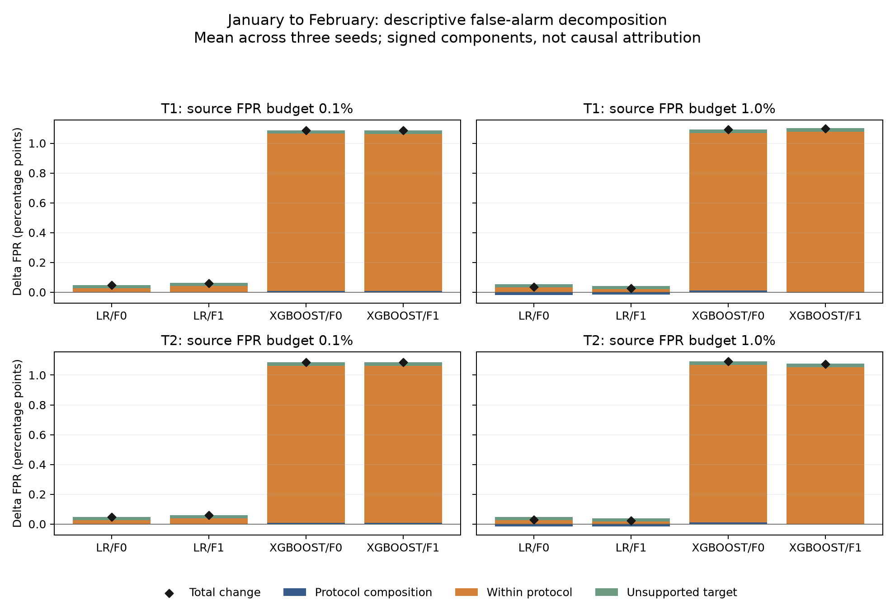
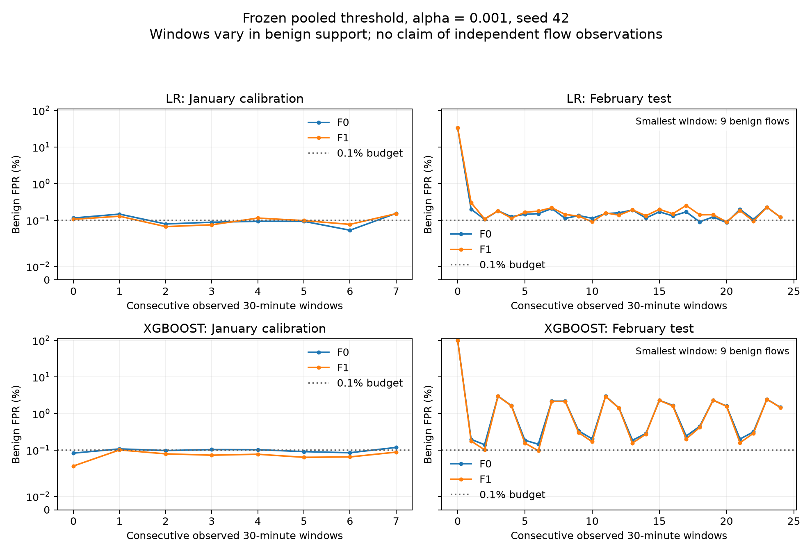

# Bukti kontribusi dari eksperimen yang selesai

Tanggal: **5 September 2026**. Status: **24 fit inti + 6 fit pendukung + 2 smoke selesai; 0 gagal.** Seluruh 30 run main telah dievaluasi; tersedia 150 operating points dan 420 baris perbandingan IAT berpasangan. Sebanyak **38 tes lulus**. Pemeriksaan artefak independen mencocokkan seluruh baris test/calibration, training subset, hash threshold sebelum test, feature count, dan hasil serialisasi. Resume melewati 30 run tanpa fit ulang.

**Keputusan ilmiah:** ada temuan empiris yang terukur untuk studi kasus konferensi, terutama diagnosis tail skor UDP. Belum cukup untuk klaim kontribusi baru yang luas atau kesiapan submit jurnal. Keberhasilan eksperimen dan novelty dinilai terpisah.

## Populasi dan kontrol

Dataset asli memiliki 2.365.424 flow dan 55 kolom. Hash ZIP/CSV cocok dengan identitas yang diberikan pengguna. Dikeluarkan 14.815 duplikat event; tidak ditemukan konflik label event. Purge temporal P_capture mengeluarkan tambahan 3.470 flow. Raw data dan seluruh baris cache tetap tersedia, dengan alasan eksklusi.

P_capture memiliki pool train 633.015, development 157.623, calibration 337.801 benign, dan test Februari **1.218.700 flow: 1.108.481 benign dan 110.219 attack**. Setiap fit main memakai 200.000 training rows; sampling identik antarmodel/fitur untuk seed yang sama. F0/F1 terdiri dari 40/48 atribut mentah; tidak ada label, IP atau timestamp absolut sebagai predictor. Group session dan identical event tidak overlap antarsplit.

P_random memiliki test 350.539 flow. Populasinya berbeda dari P_capture, sehingga selisih metrik bukan estimasi kausal leakage. Preprocessing dan early stopping hanya mengakses train/development masing-masing protokol. Semua threshold P_capture hanya memakai benign Januari dan dibekukan sebelum prediksi Februari.

## Hasil utama

Angka berikut adalah **mean ± sample standard deviation antar-3 seed**, dalam persen. Standard deviation ini bukan confidence interval temporal. T1 menggunakan pooled calibration pada alpha 0,001; T2 maksimum threshold antarblok dengan alpha yang sama. T0 adalah baseline tetap 0,5.

| Model / fitur | Aturan | FPR target (%) | Recall attack (%) | FP rata-rata |
|---|---|---:|---:|---:|
| LR / F0 | T1, budget 0,1% | 0,1471 ± 0,0014 | 99,8267 ± 0,0218 | 1.630,3 |
| LR / F1 | T1, budget 0,1% | 0,1602 ± 0,0028 | 99,8294 ± 0,0150 | 1.775,3 |
| XGBoost / F0 | T1, budget 0,1% | 1,1772 ± 0,0147 | 100,0000 ± 0,0000 | 13.049,3 |
| XGBoost / F1 | T1, budget 0,1% | 1,1682 ± 0,0130 | 99,9997 ± 0,0005 | 12.949,0 |
| XGBoost / F1 | T2, budget 0,1% | 1,1642 ± 0,0061 | 99,9997 ± 0,0005 | 12.905,3 |
| XGBoost / F1 | T0 = 0,5 | 0,0432 ± 0,0157 | 99,9362 ± 0,0108 | 479,3 |

AP rata-rata XGBoost/F1 sebesar **0,999972**, tetapi FPR T1 pada budget 0,1% mencapai **11,68 kali budget sumber**. Ini menunjukkan masalah transfer operating point meskipun ranking tetap kuat. Tidak tepat menyebutnya kegagalan total generalisasi classifier. T0 jauh mengurangi false alarm dengan sedikit pengurangan recall; tidak boleh disembunyikan demi mendukung kalibrasi yang lebih rumit. T0 juga tidak mendominasi T1 secara Pareto karena recall T1 sedikit lebih tinggi.

Pada P_random, T1 alpha 0,001 menghasilkan mean FPR XGBoost/F1 0,0602% dan recall 100%. LR/F1 menghasilkan FPR 0,0984%. Perbedaan dengan P_capture bersifat diagnostik dan mencampur populasi training/test yang berbeda.

Semua model, RF, dummy, T0/T1/T2, kedua alpha, confusion matrix, AP/ROC-AUC dan metrik lain tetap tercantum di [tabel lengkap](../results/main_metrics.csv). Dummy mencapai FPR 0 dengan recall 0; ini bukan detector yang berhasil.

## C1: perubahan false alarm dan support protokol

**Status evidence: supported, terbatas pada benchmark ini. Status novelty: belum ditetapkan.**

Pada XGBoost/F1, T1 alpha 0,001, rata-rata tiga seed menunjukkan bahwa sekitar **97,2% dari delta FPR aljabar** berada pada komponen within-stratum. Ini bukan persentase penyebab kausal. Perubahan komposisi protokol benign sendiri jauh lebih kecil.

Ilustrasi seed 42, yang tidak dipilih berdasarkan skor terbaik:

| Stratum benign | Calibration source | Target | FPR source | FPR target |
|---|---:|---:|---:|---:|
| TCP | 263.290 | 848.104 | 0,0133% | 0,0104% |
| UDP | 74.339 | 259.486 | 0,0619% | 4,5818% |
| ICMP | 0 | 255 | N/A | 100,0% |
| Other | 172 | 636 | 100,0% | 100,0% |

UDP menghasilkan 11.889 dari 12.868 FP pada run ilustrasi tersebut. ICMP tidak memiliki support benign pada **calibration source**; ini tidak berarti tidak pernah ada ICMP di training atau seluruh Januari. Other memiliki support kecil dan harus dibaca dengan hati-hati. Kontribusi unsupported ICMP terhadap total FPR sebesar 0,0230 percentage points; tidak menjadi penjelasan utama lonjakan UDP.

Untuk seed 42, delta FPR 1,0860 percentage points terdiri dari composition 0,0071, within-stratum 1,0558, dan unsupported 0,0230. Identitas menjumlah dengan residual sekitar 1,7e-18 pada skala probabilitas. Bootstrap 500 resample temporal menghasilkan interval 95% target FPR **0,7259%–1,5354%** dan komponen within-stratum **0,6214–1,4348 percentage points**. Ini conditional uncertainty dari model/threshold beku dengan **8 blok calibration dan 25 blok target**, bukan uncertainty antarorganisasi.

Artefak: `runs/*/decomposition.csv`, `score_tails.csv`, `bootstrap.csv`, `bootstrap_draws.parquet`, [perbandingan antar-seed](../results/main_seed_summary.csv). Strata dan dua alpha ditentukan sebelum evaluasi. Referensi terdekat: P11, P16, W01–W03; perbedaannya perlu diuji terhadap full text yang belum seluruhnya dapat diakses.

## C2: calibration historis dan threshold antarblok

**Status evidence: supported sebagai evaluasi, tanpa bukti solusi calibration yang unggul. Status novelty: bukan algoritma baru.**

Seluruh source empirical constraints T1/T2 lulus. Namun 41 dari 48 operating points LR/XGBoost P_capture pada dua alpha melebihi budget di target. Pada alpha 0,001, seluruh 12 T1 dan 12 T2 melebihi budget. Pada alpha 0,01, jumlah pelanggaran turun dari 11/12 T1 menjadi 6/12 T2; keberhasilan ini terutama pada LR.

T2 menurunkan FPR target pada 16/24 pasangan inti; pada 7/24 pasangan threshold persis sama dengan T1. Pada XGBoost/F1 seed 42, threshold T1/T2 alpha 0,001 sama-sama 0,0000169123 akibat distribusi skor/ties sumber. Penambahan blok tidak otomatis menggeser threshold ke bagian distribusi yang dapat menangani tail target.

Pengurangan recall terbesar T2 terhadap T1 hanya **0,00726 percentage points**, setara 8 attack flows pada test ini. Tidak ditemukan collapse recall; tidak ada kriteria kerugian operasional yang telah ditetapkan untuk menyebut perubahan tersebut tidak dapat diterima. Jangan menyatakan hipotesis kerugian recall besar telah terbukti.

Artefak: `thresholds.json`, `paired_threshold_differences.csv`, [ringkasan terhitung](../results/findings_summary.json). T1/T2 adalah heuristic empiris tanpa jaminan future FPR. Referensi terdekat P04, P16, W01–W03 sudah menutup klaim novelty dari quantile transfer saja.

## C3: paired IAT dan biaya

**Status evidence: supported sebagai kontrol dan reproducibility. Status novelty: kontribusi pendukung.**

IAT menaikkan FPR LR pada T1 alpha 0,001 di ketiga seed. Interval paired temporal untuk selisih F1−F0 tidak melintasi nol pada tiga run LR tersebut. Mean recall LR berubah sangat sedikit dan arah per-seed bervariasi. AP mean LR turun dari 0,998031 menjadi 0,992101 pada P_capture, sementara pada P_random perubahan AP kecil dan berbeda arah.

Pada XGBoost T1 alpha 0,001, selisih FPR F1−F0 adalah −0,000282 (seed 42), +0,000014 (2026), dan sekitar −0,000003 (3407), pada skala probabilitas. Tidak ada manfaat IAT yang konsisten antar-seed. Seluruh perbandingan menggunakan fit/calibration/test rows yang identik dan bootstrap berpasangan; lihat [420 baris interval IAT](../results/main_paired_iat_differences.csv).

Semua 12 fit XGBoost main memakai CUDA aktual, sementara inference semua model di CPU batch 4096 dengan warm-up dan 5 pengulangan. Peak process-tree RSS teramati maksimum 1,822 GB desimal; maksimum GPU device-wide teramati 387 MiB. GPU dipantau setiap 2 detik dan fit berlangsung singkat, sehingga angka ini dapat melewatkan puncak singkat serta mencakup proses lain. Bukan penggunaan VRAM model secara eksklusif.

Pada P_capture, waktu fit mean LR F0/F1 sekitar 0,896/1,219 detik, XGBoost F0/F1 1,524/1,518 detik, dan RF 8,569 detik. Ini waktu fit sesudah preprocessing, bukan total pipeline. Jumlah wall time worker main sekitar 401,1 detik, di luar instalasi, audit, review, tests, dan evaluasi. Biaya preprocessing+inference batch sekitar beberapa mikrodetik/flow untuk LR/XGBoost dan 14 mikrodetik/flow untuk RF; ini latency amortized batch, bukan packet-to-alert latency.

Tabel biaya dengan mean/std/min/max: [main_cost_summary.csv](../results/main_cost_summary.csv). Pareto tiga tujuan (recall naik, FPR turun, measured cost turun) mempertahankan semua kandidat: [main_pareto.csv](../results/main_pareto.csv). Berkas `preprocessing_fit_seconds` mencakup fitting transformer training dan transform development; total waktu seluruh transform calibration/test tidak diukur terpisah.

## Status hipotesis

| Hipotesis | Status | Bukti dan batas |
|---|---|---|
| H1: source empirical FPR tidak selalu bertahan di target | supported | 41/48 operating points inti melampaui alpha; semua pada alpha 0,001. XGBoost temporal intervals mendukung lonjakan besar dalam benchmark ini. |
| H2: komposisi protokol saja tidak menjelaskan perubahan FPR | supported | Komponen within-stratum dominan pada XGBoost, terutama UDP; unsupported source-calibration ICMP dilaporkan terpisah. Dekomposisi bukan kausal. |
| H3: IAT tidak otomatis memperbaiki target FPR | supported | LR memburuk pada tiga seed di alpha 0,001; arah XGBoost tidak konsisten. Klaim ini tidak membuktikan IAT selalu merugikan. |
| H4: T2 mengurangi pelanggaran tetapi dapat mengorbankan recall secara tidak dapat diterima | inconclusive | Penurunan pelanggaran terlihat pada alpha 0,01, tetapi kerugian recall maksimum kecil dan batas penerimaan operasional tidak ditentukan. Tidak ada dukungan collapse recall. |

## Batas yang tersisa dan langkah penelitian berikutnya

Satu benchmark historis dan hanya dua blok capture tetap membatasi kesimpulan. Split session memakai heuristic idle 60 detik; sensitivitas idle/embargo belum dijalankan. Bootstrap memakai satu panjang blok 30 menit dengan hanya 8 blok source; interval recall [1,1] saat semua attack terdeteksi menggambarkan degenerasi empirical resampling, bukan kepastian recall populasi.

Window test pertama memiliki **hanya 9 benign flows**; FPR 100% pada window itu tidak boleh ditonjolkan sebagai bukti kuat sendiri. Grafik memberi anotasi support kecil dan CSV mencatat seluruh denominator.

Audit eksploratif setelah freeze menemukan nonfinite rate-feature fraction sekitar 2,81% pada Januari dan 6,34% pada Februari setelah deduplikasi. Ini potensi proxy lingkungan, belum dibuktikan sebagai penyebab false alarm; lihat [diagnostic missingness](MISSINGNESS_DIAGNOSTIC.md). Tidak ada perubahan model dari temuan ini.

Arah konferensi memerlukan pemusatan cerita pada diagnosis UDP dan perbandingan T0/T1/T2, pembacaan lanjutan karya terdekat, serta pembatasan klaim yang tegas. Untuk memperkuat jalur jurnal, prioritaskan replikasi pada capture/domain independen dan sensitivitas grouping/block length, bukan menambah daftar classifier. Extended training budget, F2, matched-target sensitivity, MLP dan SHAP tidak dijalankan; semuanya di luar main wajib.
