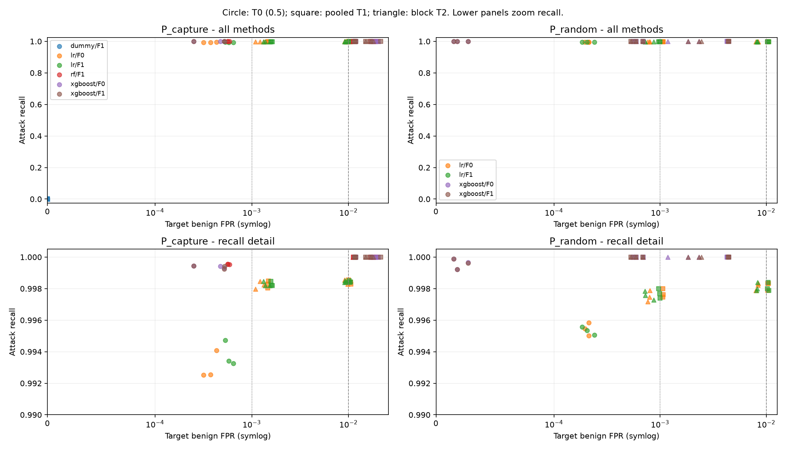

# Experiment report

Profile: `main`. Evaluated fitted models: **30**. Recorded run states: `{"completed": 30}`.

These are measured frozen-prediction results. Smoke results, when selected, are debugging evidence only. The test holdout was not used for model/feature/threshold selection. Earlier dataset-label audits were descriptive exploration, so this is not a claim that humans never viewed test labels.

## Detection results and variation between seeds

| protocol | model | feature_set | threshold_id | fpr_mean | fpr_std | fpr_count | recall_mean | recall_std | recall_count | average_precision_mean |
| --- | --- | --- | --- | --- | --- | --- | --- | --- | --- | --- |
| P_capture | dummy | F1 | T0 | 0 | 0 | 3 | 0 | 0 | 3 | 0.0904398 |
| P_capture | dummy | F1 | T1_alpha_0.001 | 0 | 0 | 3 | 0 | 0 | 3 | 0.0904398 |
| P_capture | dummy | F1 | T1_alpha_0.01 | 0 | 0 | 3 | 0 | 0 | 3 | 0.0904398 |
| P_capture | dummy | F1 | T2_alpha_0.001 | 0 | 0 | 3 | 0 | 0 | 3 | 0.0904398 |
| P_capture | dummy | F1 | T2_alpha_0.01 | 0 | 0 | 3 | 0 | 0 | 3 | 0.0904398 |
| P_capture | lr | F0 | T0 | 0.000374085 | 5.7739e-05 | 3 | 0.99305 | 0.000895918 | 3 | 0.998031 |
| P_capture | lr | F0 | T1_alpha_0.001 | 0.00147078 | 1.35421e-05 | 3 | 0.998267 | 0.000218315 | 3 | 0.998031 |
| P_capture | lr | F0 | T1_alpha_0.01 | 0.0103445 | 0.000308789 | 3 | 0.998418 | 0.000136193 | 3 | 0.998031 |
| P_capture | lr | F0 | T2_alpha_0.001 | 0.00121367 | 0.000124512 | 3 | 0.998228 | 0.000250176 | 3 | 0.998031 |
| P_capture | lr | F0 | T2_alpha_0.01 | 0.00943032 | 0.000354378 | 3 | 0.998415 | 0.000140653 | 3 | 0.998031 |
| P_capture | lr | F1 | T0 | 0.000585185 | 5.52762e-05 | 3 | 0.993797 | 0.000803464 | 3 | 0.992101 |
| P_capture | lr | F1 | T1_alpha_0.001 | 0.00160159 | 2.78106e-05 | 3 | 0.998294 | 0.000149908 | 3 | 0.992101 |
| P_capture | lr | F1 | T1_alpha_0.01 | 0.0102504 | 0.000174731 | 3 | 0.998442 | 6.17576e-05 | 3 | 0.992101 |
| P_capture | lr | F1 | T2_alpha_0.001 | 0.00141184 | 0.000112918 | 3 | 0.998285 | 0.000149358 | 3 | 0.992101 |
| P_capture | lr | F1 | T2_alpha_0.01 | 0.0092114 | 0.000172075 | 3 | 0.998442 | 6.17576e-05 | 3 | 0.992101 |
| P_capture | rf | F1 | T0 | 0.000572255 | 1.53716e-05 | 3 | 0.999537 | 1.57146e-05 | 3 | 0.999982 |
| P_capture | rf | F1 | T1_alpha_0.001 | 0.0113937 | 0.000244279 | 3 | 1 | 0 | 3 | 0.999982 |
| P_capture | rf | F1 | T1_alpha_0.01 | 0.0180917 | 0.00118391 | 3 | 1 | 0 | 3 | 0.999982 |
| P_capture | rf | F1 | T2_alpha_0.001 | 0.0112719 | 0.000240126 | 3 | 1 | 0 | 3 | 0.999982 |
| P_capture | rf | F1 | T2_alpha_0.01 | 0.0175838 | 0.000666342 | 3 | 1 | 0 | 3 | 0.999982 |
| P_capture | xgboost | F0 | T0 | 0.000414381 | 0.000142903 | 3 | 0.999386 | 6.6877e-05 | 3 | 0.999979 |
| P_capture | xgboost | F0 | T1_alpha_0.001 | 0.0117723 | 0.000147063 | 3 | 1 | 0 | 3 | 0.999979 |
| P_capture | xgboost | F0 | T1_alpha_0.01 | 0.0189286 | 0.00137684 | 3 | 1 | 0 | 3 | 0.999979 |
| P_capture | xgboost | F0 | T2_alpha_0.001 | 0.0116655 | 0.000133324 | 3 | 1 | 0 | 3 | 0.999979 |
| P_capture | xgboost | F0 | T2_alpha_0.01 | 0.0188967 | 0.00137437 | 3 | 1 | 0 | 3 | 0.999979 |
| P_capture | xgboost | F1 | T0 | 0.000432424 | 0.000156531 | 3 | 0.999362 | 0.000108242 | 3 | 0.999972 |
| P_capture | xgboost | F1 | T1_alpha_0.001 | 0.0116818 | 0.000129704 | 3 | 0.999997 | 5.23821e-06 | 3 | 0.999972 |
| P_capture | xgboost | F1 | T1_alpha_0.01 | 0.0178283 | 0.0033693 | 3 | 1 | 0 | 3 | 0.999972 |
| P_capture | xgboost | F1 | T2_alpha_0.001 | 0.0116424 | 6.14866e-05 | 3 | 0.999997 | 5.23821e-06 | 3 | 0.999972 |
| P_capture | xgboost | F1 | T2_alpha_0.01 | 0.0166339 | 0.00149253 | 3 | 1 | 0 | 3 | 0.999972 |
| P_random | lr | F0 | T0 | 0.000207522 | 1.04185e-05 | 3 | 0.995437 | 0.000415958 | 3 | 0.997466 |
| P_random | lr | F0 | T1_alpha_0.001 | 0.00106067 | 3.47284e-06 | 3 | 0.997691 | 0.000284394 | 3 | 0.997466 |
| P_random | lr | F0 | T1_alpha_0.01 | 0.0103711 | 6.67336e-05 | 3 | 0.99819 | 0.000255974 | 3 | 0.997466 |
| P_random | lr | F0 | T2_alpha_0.001 | 0.000785977 | 2.00253e-05 | 3 | 0.997506 | 0.000363414 | 3 | 0.997466 |
| P_random | lr | F0 | T2_alpha_0.01 | 0.00824373 | 0.000242459 | 3 | 0.998153 | 0.000230732 | 3 | 0.997466 |
| P_random | lr | F1 | T0 | 0.000209527 | 2.88998e-05 | 3 | 0.995326 | 0.000249903 | 3 | 0.997618 |
| P_random | lr | F1 | T1_alpha_0.001 | 0.000984476 | 1.51377e-05 | 3 | 0.997691 | 0.00030523 | 3 | 0.997618 |
| P_random | lr | F1 | T1_alpha_0.01 | 0.0103971 | 0.000129953 | 3 | 0.998097 | 0.000261905 | 3 | 0.997618 |
| P_random | lr | F1 | T2_alpha_0.001 | 0.000771941 | 8.42297e-05 | 3 | 0.997562 | 0.0002771 | 3 | 0.997618 |
| P_random | lr | F1 | T2_alpha_0.01 | 0.00820463 | 9.33799e-05 | 3 | 0.998097 | 0.000261905 | 3 | 0.997618 |
| P_random | xgboost | F0 | T0 | 2.00504e-05 | 6.26074e-06 | 3 | 0.999594 | 0.000338622 | 3 | 0.999999 |
| P_random | xgboost | F0 | T1_alpha_0.001 | 0.000614546 | 7.17626e-05 | 3 | 1 | 0 | 3 | 0.999999 |
| P_random | xgboost | F0 | T1_alpha_0.01 | 0.0043329 | 8.45512e-05 | 3 | 1 | 0 | 3 | 0.999999 |
| P_random | xgboost | F0 | T2_alpha_0.001 | 0.000614546 | 7.17626e-05 | 3 | 1 | 0 | 3 | 0.999999 |
| P_random | xgboost | F0 | T2_alpha_0.01 | 0.00178449 | 0.000576499 | 3 | 1 | 0 | 3 | 0.999999 |
| P_random | xgboost | F1 | T0 | 2.00504e-05 | 6.26074e-06 | 3 | 0.999575 | 0.000334056 | 3 | 0.999998 |
| P_random | xgboost | F1 | T1_alpha_0.001 | 0.000601513 | 7.88877e-05 | 3 | 1 | 0 | 3 | 0.999998 |
| P_random | xgboost | F1 | T1_alpha_0.01 | 0.00441711 | 1.71017e-05 | 3 | 1 | 0 | 3 | 0.999998 |
| P_random | xgboost | F1 | T2_alpha_0.001 | 0.000601513 | 7.88877e-05 | 3 | 1 | 0 | 3 | 0.999998 |
| P_random | xgboost | F1 | T2_alpha_0.01 | 0.00220254 | 0.000323454 | 3 | 1 | 0 | 3 | 0.999998 |

AP uses sklearn average_precision_score. Alpha is a source calibration FPR budget. Strict prediction rule: score > threshold. FPR is FP/(FP+TN). Standard deviation is sample standard deviation across valid runs; one valid seed gives N/A standard deviation. Each metric has its own valid-run count in the CSV.

## False-alarm transfer decomposition

| protocol | model | feature_set | threshold_id | delta_fpr_mean | composition_mean | within_stratum_mean | unsupported_target_mean |
| --- | --- | --- | --- | --- | --- | --- | --- |
| P_capture | dummy | F1 | T0 | 0 | 0 | 0 | 0 |
| P_capture | dummy | F1 | T1_alpha_0.001 | 0 | 0 | 0 | 0 |
| P_capture | dummy | F1 | T1_alpha_0.01 | 0 | 0 | 0 | 0 |
| P_capture | dummy | F1 | T2_alpha_0.001 | 0 | 0 | 0 | 0 |
| P_capture | dummy | F1 | T2_alpha_0.01 | 0 | 0 | 0 | 0 |
| P_capture | lr | F0 | T0 | 0.00035731 | -1.46152e-07 | 0.000281076 | 7.63808e-05 |
| P_capture | lr | F0 | T1_alpha_0.001 | 0.000473153 | -1.38717e-05 | 0.000272015 | 0.000215009 |
| P_capture | lr | F0 | T1_alpha_0.01 | 0.000344516 | -0.000178686 | 0.000307892 | 0.00021531 |
| P_capture | lr | F0 | T2_alpha_0.001 | 0.000458791 | -9.49325e-06 | 0.000253275 | 0.000215009 |
| P_capture | lr | F0 | T2_alpha_0.01 | 0.0002997 | -0.000162715 | 0.000247106 | 0.00021531 |
| P_capture | lr | F1 | T0 | 0.00057137 | -9.17682e-08 | 0.000360362 | 0.0002111 |
| P_capture | lr | F1 | T1_alpha_0.001 | 0.000603962 | -1.33046e-05 | 0.000403461 | 0.000213806 |
| P_capture | lr | F1 | T1_alpha_0.01 | 0.000250393 | -0.000167263 | 0.00020355 | 0.000214107 |
| P_capture | lr | F1 | T2_alpha_0.001 | 0.00059874 | -9.99572e-06 | 0.00039493 | 0.000213806 |
| P_capture | lr | F1 | T2_alpha_0.01 | 0.000222878 | -0.000151598 | 0.000160369 | 0.000214107 |
| P_capture | rf | F1 | T0 | 0.000572255 | 0 | 0.000359351 | 0.000212904 |
| P_capture | rf | F1 | T1_alpha_0.001 | 0.0104375 | 3.07967e-05 | 0.0101766 | 0.000230045 |
| P_capture | rf | F1 | T1_alpha_0.01 | 0.00897788 | 0.000167769 | 0.00858006 | 0.000230045 |
| P_capture | rf | F1 | T2_alpha_0.001 | 0.0106285 | 2.39511e-05 | 0.0103745 | 0.000230045 |
| P_capture | rf | F1 | T2_alpha_0.01 | 0.00902257 | 0.000177434 | 0.00861509 | 0.000230045 |
| P_capture | xgboost | F0 | T0 | 0.000414381 | 0 | 0.000273347 | 0.000141034 |
| P_capture | xgboost | F0 | T1_alpha_0.001 | 0.0108763 | 6.76839e-05 | 0.0105785 | 0.000230045 |
| P_capture | xgboost | F0 | T1_alpha_0.01 | 0.010917 | 0.000121345 | 0.0105656 | 0.000230045 |
| P_capture | xgboost | F0 | T2_alpha_0.001 | 0.0108623 | 6.92259e-05 | 0.010563 | 0.000230045 |
| P_capture | xgboost | F0 | T2_alpha_0.01 | 0.0109137 | 0.000121142 | 0.0105625 | 0.000230045 |
| P_capture | xgboost | F1 | T0 | 0.000432424 | 0 | 0.000292593 | 0.000139831 |
| P_capture | xgboost | F1 | T1_alpha_0.001 | 0.0108558 | 6.96191e-05 | 0.0105562 | 0.000230045 |
| P_capture | xgboost | F1 | T1_alpha_0.01 | 0.0109732 | -2.9882e-05 | 0.010773 | 0.000230045 |
| P_capture | xgboost | F1 | T2_alpha_0.001 | 0.010852 | 7.02717e-05 | 0.0105516 | 0.000230045 |
| P_capture | xgboost | F1 | T2_alpha_0.01 | 0.0107497 | -1.20441e-05 | 0.0105317 | 0.000230045 |
| P_random | lr | F0 | T0 | -3.37018e-05 | -1.47687e-06 | -3.2225e-05 | 0 |
| P_random | lr | F0 | T1_alpha_0.001 | 6.18817e-05 | 3.496e-05 | 2.69217e-05 | 0 |
| P_random | lr | F0 | T1_alpha_0.01 | 0.000371263 | 7.3234e-05 | 0.000298029 | 0 |
| P_random | lr | F0 | T2_alpha_0.001 | 4.43632e-05 | 3.29512e-05 | 1.14121e-05 | 0 |
| P_random | lr | F0 | T2_alpha_0.01 | 0.000417916 | 6.81484e-05 | 0.000349768 | 0 |
| P_random | lr | F1 | T0 | -3.86743e-05 | -1.21191e-06 | -3.74624e-05 | 0 |
| P_random | lr | F1 | T1_alpha_0.001 | -1.43099e-05 | 3.21404e-05 | -4.64504e-05 | 0 |
| P_random | lr | F1 | T1_alpha_0.01 | 0.000397328 | 7.02222e-05 | 0.000327106 | 0 |
| P_random | lr | F1 | T2_alpha_0.001 | -2.15053e-05 | 3.12711e-05 | -5.27763e-05 | 0 |
| P_random | lr | F1 | T2_alpha_0.01 | 0.000142578 | 6.47998e-05 | 7.77786e-05 | 0 |
| P_random | xgboost | F0 | T0 | -3.87259e-06 | 1.04853e-06 | -4.92112e-06 | 0 |
| P_random | xgboost | F0 | T1_alpha_0.001 | 6.5313e-05 | 3.65353e-05 | 2.87778e-05 | 0 |
| P_random | xgboost | F0 | T1_alpha_0.01 | -0.00555827 | -0.000327426 | -0.00523085 | 0 |
| P_random | xgboost | F0 | T2_alpha_0.001 | 6.5313e-05 | 3.65353e-05 | 2.87778e-05 | 0 |
| P_random | xgboost | F0 | T2_alpha_0.01 | -0.000549003 | -0.000125043 | -0.00042396 | 0 |
| P_random | xgboost | F1 | T0 | -2.8758e-06 | 1.04262e-06 | -3.91842e-06 | 0 |
| P_random | xgboost | F1 | T1_alpha_0.001 | 5.8261e-05 | 3.62804e-05 | 2.19806e-05 | 0 |
| P_random | xgboost | F1 | T1_alpha_0.01 | -0.00556876 | -0.000327586 | -0.00524117 | 0 |
| P_random | xgboost | F1 | T2_alpha_0.001 | 5.8261e-05 | 3.62804e-05 | 2.19806e-05 | 0 |
| P_random | xgboost | F1 | T2_alpha_0.01 | -0.000794815 | -0.000137605 | -0.000657211 | 0 |

Delta FPR = composition + within-stratum + unsupported-target components, using source benign protocol support. TCP=6, UDP=17, ICMP=1, Other=remaining values. Missing conditional support is N/A. This is a descriptive identity, not causal attribution or a new theorem. Target benign labels are used only for post-freeze evaluation.

## Paired uncertainty and IAT ablation

Matched F1-minus-F0 comparisons: 420 metric/threshold/seed rows; see `results/main_paired_iat_differences.csv`.

Each run contains `bootstrap.csv` and `bootstrap_draws.parquet`: 95% percentile intervals from temporal 30-minute blocks by default, with source and target resampled separately within capture. Identical temporal draws pair thresholds and identical-row feature ablations. Models and thresholds stay frozen. Resample counts and valid denominator support are explicit. Few blocks and residual between-block dependence limit the intervals; these intervals do not estimate uncertainty across organizations. Calibration with no attacks yields N/A delta recall.

Per-attack files report binary detection recall and support, plus descriptive binomial Wilson intervals whose independence assumption is not valid for correlated flows. Per-window negative/attack supports and temporal benign-score tails are retained per run.

## Measured computation and Pareto comparison

`results/main_pareto.csv` retains every eligible method and marks nondominated recall/FPR/measured preprocessing-plus-inference cost points. Comparisons are grouped by protocol, seed, inference batch size and inference device. Missing measured costs produce invalid Pareto status. Zero-recall all-benign methods remain visible and are not presented as successful detectors.

Training time, preprocessing fit time, process-tree RSS, measured GPU device allocation, artifact bytes, warm-up/batch details and model-only versus full inference are recorded in run profiling artifacts. GPU allocation is a device measurement when available, not necessarily process-exclusive. Feature capture/extraction and packet-to-alert latency are outside this CSV experiment.

## Scope and evidence limits

This is one historical benchmark with two analysis capture blocks. Random and chronological protocols have different target populations; their difference is not a causal leakage estimate. The four-block conservative threshold is a source-only heuristic, not a future-FPR guarantee or conformal method. An empirical effect does not establish novelty. See CONTRIBUTION_EVIDENCE.md for the recorded experimental controls and results.

Full operating points: `results/main_metrics.csv`; valid seed aggregates: `results/main_seed_summary.csv`. Per-run artifacts: metrics.json, thresholds.json, decomposition.csv, per_attack.csv, windows.csv, score_tails.csv, bootstrap.csv, paired_threshold_differences.csv.
